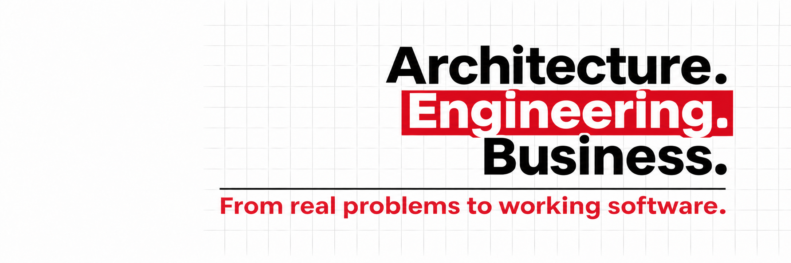
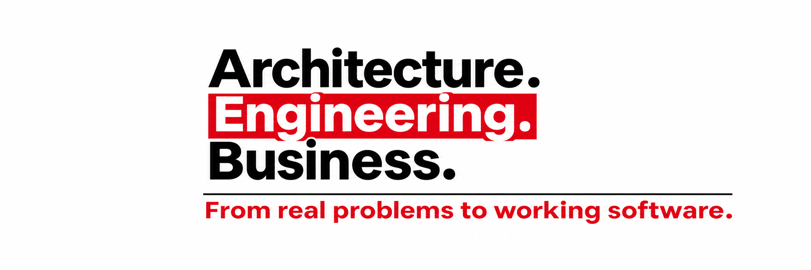
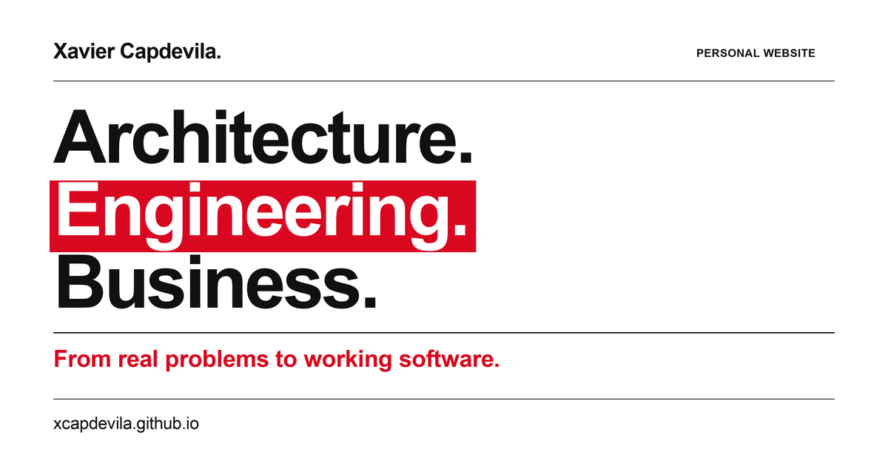

# Media

Final personal branding assets for the website, LinkedIn and project previews.

| Asset | Dimensions | Design |
| --- | --- | --- |
| [LinkedIn banner](linkedin-banner-right.png) | 2172 × 724 PNG | Right-aligned words, gray grid and red Engineering highlight. |
| [Website brand artwork](website-banner-left.png) | 2172 × 724 PNG | Left-aligned words on white, without a grid. |
| [Website and project thumbnail](../assets/personal-website-social.png) | 1200 × 630 PNG | Left-aligned brand on white, with name and website address. |
| [Editable thumbnail source](../assets/personal-website-social.svg) | 1200 × 630 SVG | Editable typography and shapes for the social preview. |

## LinkedIn banner

This is the original wide artwork. The design was reviewed with a centered 4:1 crop; adjust the crop in the banner editor when uploading it.

## Website brand artwork

The live website renders its headline as responsive HTML and CSS. This PNG is the matching standalone artwork.

## Social preview

The PNG and SVG in `assets` are the canonical thumbnail files. The website's Open Graph and Twitter metadata use that PNG.

The existing [repository license](../LICENSE) is preserved.
